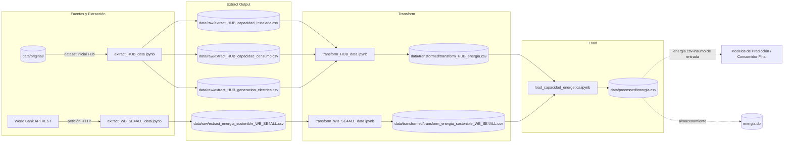
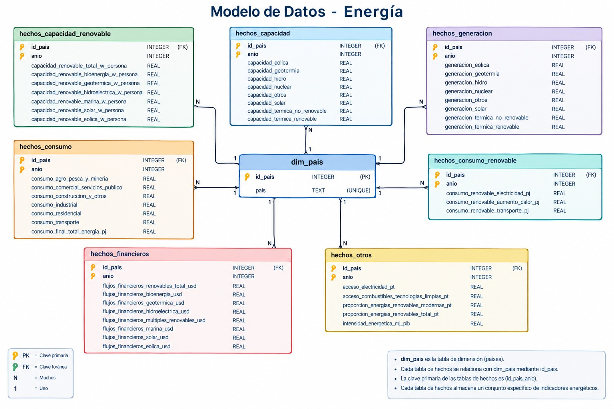

# Predicción de la demanda eléctrica mediante fuentes de energía renovables en los 20 países con mayor consumo de América Latina
Este pipeline de ETL extrae datos históricos de generación, capacidad instalada y consumo eléctrico (vía HUB de energía) junto con los indicadores de acceso, sostenibilidad e intensidad energética (vía API REST de World Bank SE4ALL), los unifica para los 20 países con mayor consumo eléctrico de América Latina en una ventana temporal común (2000-2021), realiza el proceso de limpieza, imputación estructural, escalado y pivoteo en formato ancho; finalmente, en la fase de carga, genera un dataset consolidado y una base de datos optimizada para posteriormente ser usado para entrenar un modelo predictivo de demanda eléctrica regional.

**Curso:** ETL — Maestría en Inteligencia Artificial y Ciencia de Datos, Universidad Autónoma de Occidente
**Periodo:** 2026-2
**Docente:** Fernando Barraza Alvarado
## Integrantes

| Nombre | Código | Usuario de GitHub |
|---|---|---|
| Andres Coral | 22615813 | @Anfeco20 |
| Carlos Daza | 22615364 | @carlosdazar |
| Walter Arredondo| 22615208 | @omnicontrol-tech |

## Tabla de contenido

1. [Descripción del problema](#1-descripción-del-problema)
2. [Fuentes de datos](#2-fuentes-de-datos)
3. [Arquitectura del pipeline](#3-arquitectura-del-pipeline)
4. [Estructura del repositorio](#4-estructura-del-repositorio)
5. [Requisitos](#5-requisitos)
6. [Instalación y configuración](#6-instalación-y-configuración)
7. [Ejecución](#7-ejecución)
8. [Detalle de las etapas ETL](#8-detalle-de-las-etapas-etl)
9. [Modelo y diccionario de datos](#9-modelo-y-diccionario-de-datos)
10. [Calidad de datos y validaciones](#10-calidad-de-datos-y-validaciones)
11. [Resultados](#11-resultados)
12. [Limitaciones y trabajo futuro](#12-limitaciones-y-trabajo-futuro)
13. [Referencias](#13-referencias)

## 1. Descripción del problema
Cuando se habla de demanda eléctrica de un país, se hace referencia a la cantidad de electricidad que cierta cantidad de consumidores requieren para abastecer sus necesidades (industrias, oficinas, comercio, hogares). El incremento socioeconómico y poblacional, así como los cambios en los patrones de consumo, han sido factores determinantes para el aumento en la demanda eléctrica en los países de América Latina. Esta situación ha sido un desafío para los sistemas eléctricos de la región, por lo cual se ha buscado la incorporación de nuevas fuentes de energías renovables que permitan satisfacer las necesidades futuras de electricidad.

Este proyecto surge con la necesidad de consolidar y preparar un flujo de datos limpio y estructurado que integre diferentes métricas de consumo, generación y sostenibilidad eléctrica de los 20 países con mayor consumo energético de la región, con el fin de generar diferentes mecanismos que permitan predecir la demanda eléctrica y analizar en qué medida es posible satisfacerla mediante el uso de energías renovables.

**Objetivo:** Generar un dataset final “maestro” unificado, estandarizado en formato ancho, acotado en una rejilla temporal al periodo de 2000-2021, con datos limpios de generación (PJ), capacidad instalada (PJ), consumo por sector (PJ), así como los indicadores de acceso (PJ), sostenibilidad (USD) e intensidad eléctrica (PJ). El cual puede ser utilizado como insumo inicial para entrenar modelos de predicción de la demanda eléctrica regional. También puede ser aplicado en el análisis comportamental de la generación y consumo eléctrico por país en una rejilla temporal de 2000 a 2021.

## 2. Fuentes de datos

| Fuente | Tipo (CSV, API, BD, web) | Origen / URL | Tamaño aprox. | Frecuencia de actualización | Licencia |
|---|---|---|---|---|---|
| **Hub de Energía** (Generación, Capacidad y Consumo) | Archivo Excel | Hub de Energía : https://hubenergia.org/index.php/es/indicators/capacidad-generacion-y-consumo-de-electricidad | ~1,320 filas × 24 columnas (3 hojas) | Anual | Uso publico |
| **World Bank SE4ALL API** (Indicadores de acceso, sostenibilidad e intensidad energética) | API REST (JSON) |World Bank Data API: https://data360api.worldbank.org/data360/data?DATABASE_ID=WB_SE4ALL| ~4,400 registros (8 indicadores × 20 países × 22 años) | Anual |CC-BY 4.0|

### Cobertura Geográfica y Temporal
* **Periodo de estudio:** 2000 – 2021 (rejilla temporal uniforme de 22 años).
* **Alcance geográfico:** Top 20 países con mayor consumo energético de América Latina:

País | País |
|---|---|
| 1. Brasil | 11. Uruguay|
| 2. México | 12. Guatemala |
| 3. Argentina | 13. Costa Rica |
| 4. Chile | 14. Panama |
| 5. Colombia | 15. Bolivia |
| 6. Perú | 16. Honduras |
| 7. Venezuela | 17. El Salvador |
| 8. Ecuador | 18. Nicaragua|
| 9. República Dominicana | 19. Cuba |
| 10. Paraguay | 20. Haití |

## 3. Arquitectura del pipeline


El pipeline esta orquestado mediante un notebook principal (pipeline.ipynb), ejecuta de forma modular la siguiente secuencia de flujo ETL:
1. Extract: Para la fuente Hub se ejecuta el notebook de extracción "extract_HUB_data.ipynb" obteniendo el archivo original  xlsx de la carpeta data/original y para la API del banco mundial se ejecuta el notebook "extract_WB_SE4ALL_data.ipynb". Se generan los siguientes archivos que se depositan en la carpeta data/raw:
* extract_HUB_capacidad_instalada.csv
* extract_HUB_capacidad_consumo.csv
* extract_HUB_generacion_electrica.csv
* extract_energia_sostenible_WB_SE4ALL.csv

2. Transform: lee los datos que se obtuvieron de la fase de extracción de data/raw. Aplica limpieza, estandarización de variables, homologación de unidades e imputación de datos nulos o faltantes. Los resultados generados que se depositan en la carpeta data/transformed son:
* transform_HUB_energia.csv.csv
* transform_energia_sostenible_WB_SE4ALL.csv
  
3. Load: Toma los conjuntos de datos transformados de data/transformed/, realiza la consolidación final (merge) en formato ancho (wide) para la rejilla temporal 2000–2021 y exporta el Dataset Maestro unificado en data/processed/ y lo carga en una base SQLite.
- **Scripts:** `load/load_capacidad_energetica.ipynb`
- **Destino:** `data/energia.db` (SQLite) y `data/energia.csv`

**Tecnologías:** Python 3.10+, pandas, NumPy, requests, openpyxl, matplotlib, ydata-profiling, subprocess, pathlib, Google Colab / Google Drive, Git/GitHub, SQLAlchemy, PostgreSQL

Estas herramientas se reparten según la etapa del ETL en la que trabajan. Python es el lenguaje que une todo, y pathlib y subprocess ayudan a manejar las rutas de archivos y a ejecutar cada etapa por separado, deteniendo el proceso si una falla. En la extracción, requests trae datos de APIs o de internet y openpyxl lee y escribe archivos Excel. En la transformación, pandas y NumPy limpian, unen y calculan, mientras que ydata-profiling y matplotlib sirven para revisar los datos y dejar evidencia con reportes y gráficos. En la carga, SQLAlchemy conecta Python con la base de datos y PostgreSQL funciona como destino, con integridad de datos y varios usuarios a la vez. Por último, Google Colab y Drive dan un entorno compartido en la nube, y Git y GitHub guardan el historial de cambios y facilitan el trabajo en grupo y la entrega al docente.

## 4. Estructura del repositorio

```
├── data               <- Conjuntos de datos
│
│   ├── original       <- Conjuntos de datos originales HUB de energía.
│   │
│   │  ├── hub.xlsx
│   │
│   ├── transformed    <- Conjuntos de datos finales trasformados, listos para load.
│   │ 
│   │  ├── transform_HUB_energia.csv
│   │  ├── transform_energia_sostenible_WB_SE4ALL.csv
│   │
│   └── raw            <- Datos originales de la extracción, sin modificar.
│   │ 
│   │  ├── extract_HUB_capacidad_instalada.csv
│   │  ├── extract_HUB_capacidad_consumo.csv
│   │  ├── extract_HUB_generacion_electrica.csv
│   │  ├── extract_energia_sostenible_WB_SE4ALL.csv
│   │
│   └── processed      <- Dataset "Maestro" final, listo para análisis o modelado.
│   │ 
│   │  ├── energia.csv
│   │  ├── energia.db
│   │ 
│   └── model          <- Modelo Predicción de la demanda eléctrica 20 países con mayor consumo de América Latina.
│   │ 
├   ├  ├── modelo_extratrees_energia.pkl
├
├── extract            <- Código de extracción de datos.
│   │ 
│   │  ├── extract_HUB_data.ipynb
│   │  ├── extract_WB_SE4ALL_data.ipynb
├
├── transform          <- Código de limpieza y transformación.
│   │ 
│   │  ├── transform_HUB_data.ipynb
│   │  ├── transform_WB_SE4ALL_data.ipynb
├
├── load               <- Código de carga al destino.
│   │  ├── load_capacidad_energetica.ipynb
├
├── model              <- Código  Modelo Predicción de la demanda eléctrica 20 países con mayor consumo de América Latina.
│   │  ├── model_demanda_atendida_renovable.ipynb
├
├── docs               <- tiene manuales, guías o capturas de pantalla.
│   │ 
│   │  ├── modelo_datos.jpeg
│   │  ├── 
│ 
├── pipeline.py        <- Orquesta la ejecución completa (extract → transform → load).
│
├── requirements.txt   <- Dependencias del proyecto.
│
├── .gitignore         <- Archivos que git debe ignorar.
│
└── README.md          <- Este archivo.
```
## 5. Requisitos
### Requisitos del sistema
**Entorno Principal:** Google Colab ( Python 3.10+ configuración de la nube) almacenamiento en Google Drive.

**Ejecución Local (Opcional):** Python 3.10 o superior y Júpiter Notebook/ JupyterLab.

### Dependencias requeridas
Las principales librerías utilizadas en los notebooks son:
- "Pandas" ( manipulación de datos y estructuras Dataset)
- "Numpy"  ( operaciones numéricas y vectoriales)
- "Request" ( peticiones HTTP a la API del Banco Mundial)
- "openpyxl" ( lectura y escritura de archivos Excel de Hub de energía)
- "matplotlib" (generación de gráficos)
- "ydata-profiling" (generación automática de reportes HTML para EDA)
- "Sqlite3" (motor de base de datos relacional y ligero que funciona de forma autónoma, sin necesidad de instalar o configurar un servidor independiente)
## 6. Instalación y configuración
### Instrucciones de ejecución
#### Opción 1 (Recomendada) Ejecutar en Google Colab
1. Subir la carpeta del proyecto a la unidad de **Google Drive** en la ruta:
   "/My Drive/Colab Notebooks/Master/1.ETL/entregable3/"
2. Asegurase de tener el dataset inicial HUB, lo puede descargar en https://hubenergia.org/index.php/es/indicators/capacidad-generacion-y-consumo-de-electricidad, este se debe guardar en la ruta "data/original/"
3. Abrir y ejecutar el notebook orquestador **"pipeline.ip`ynb"**
4. El notebook montará automáticamente Google Drive mediante "drive.mount('/content/drive')" y ejecutará de forma secuencial los notebooks de las carpetas `extract/`, `transform/` y `load/`.
#### Opción 2 Ejecución Local
1. Clonar el repositorio (https://github.com/carlosdazar/etl-demanda-electrica.git)
2. Correr el local
- Dependencias listadas en `requirements.txt`
```bash
# 1. Clonar el repositorio
git clone https://github.com/[usuario]/[repositorio].git
cd [repositorio]

# 2. Crear y activar el entorno virtual
python -m venv .venv
source .venv/bin/activate        # Windows: .venv\Scripts\activate

# 3. Instalar dependencias
pip install -r requirements.txt
```
### Variables de entorno
Este proyecto no requiere llaves API ni credenciales privadas ya que es de acceso público.
Para mantener la flexibilidad de ejecución entre entono local y Google Colab, se utiliza la variable global de ruta base `BASE_DIR` en cada notebook:
 Variable | Descripción | Ejemplo |
|---|---|---|
| `BASE_DIR` | Ruta raíz del proyecto donde se leen y escriben las capas de datos (`data/`)| `/content/drive/MyDrive/Colab Notebooks/Master/1.ETL/entregable3` |
| `API_WB_SE4ALL_URL` | Endpoint base público de la API del Banco Mundial| https://data360api.worldbank.org/data360/data?DATABASE_ID=WB_SE4ALL |

La etapa Load con SQLite **no requiere credenciales ni variables de entorno**: la base es un archivo local (`data/processed/energia.db`). Si se migra a un motor con servidor (PostgreSQL, MySQL), agregue aquí las variables de conexión usando un archivo `.env` (incluido en `.gitignore`).

### Obtención de los datos
Los datos crudos usados en el pipeline provienen de dos fuentes distintas y se gestionan de la siguiente manera:

1.**HUB de energía**

**método de obtención**: Requiere descarga previa en https://hubenergia.org/index.php/es/indicators/capacidad-generacion-y-consumo-de-electricidad. Se debe guardar manualmente en la carpeta `data/original/`

2. **World Bank (SE4ALL API REST)**

**método de obtención**: Extracción desde  la API RES JSON https://data360api.worldbank.org/data360/data?DATABASE_ID=WB_SE4ALL

## 7. Ejecución

### Pipeline completo

El pipeline se encuentra orquestado mediante el notebook `pipeline.ipynb`.

**En Google Colab/ Jupyter** Abrir `pipeline.ipynb`. y seleccione la opción **"Ejecutar todas"**.
```bash
  jupyter nbconvert --to notebook --execute pipeline.ipynb
```
### Ejecución por Etapas

Si se requiere ejecutar las etapas por separado se debe seguir el siguiente orden secuencial:

```bash
#1. Extracción 
# Abrir y ejecutar
#extract/extract_HUB_data.ipynb
#extract/extract_WB_SE4ALL_data.ipynb
#2. Transformación
# Abrir y ejecutar
#transform/transform_HUB_data.ipynb
#transform/ transform_energia_sostenible_WB_SE4ALL.csv
#3. Carga
# Abrir y ejecutar
#load/energia.scv
```
### Salida esperada

Al finalizar la ejecución ya sea con el pipeline o por etapas se obtienen los siguientes resultados:

En `data/raw`

* `extract_HUB_capacidad_instalada.csv`
* `extract_HUB_capacidad_consumo.csv`
* `extract_HUB_generacion_electrica.csv`
* `extract_energia_sostenible_WB_SE4ALL.csv`

En `data/transformed`

* `transform_HUB_energia.csv`
* `transform_energia_sostenible_WB_SE4ALL.csv`

En `data/processed`
* `energia.csv` ( Dataset final consolidado en formato ancho para 20 Países de América Latina entre los años 2000 a 2021)
* `energia.db` ( Dataset final consolidado en la base de datos SQlite)
  
En `extract`
* Reportes de perfilado y/o EDA en formato HTML (`ydata-profiling`)

El tiempo estimado de ejecución es entre 2 y 6 Minutos en total ( depende de la latencia de respuesta de la API del banco Mundial)

#### Nota:
Para ver la Informacion detallada de los procesos realizados en cada etapa ETL, ejecutar cada Notebook en formna individual

## 8. Detalle de las etapas ETL

### 8.1 Extract

- **Qué hace:** Extrae los datos generación , capacidad y consumo por sector de los 20 países de mayor consumo de América Latina a partir del dataset inicial HUB de energía y realiza consultas HTTP  a la API REST del banco mundial SE4ALL para obtener los Indicadores de acceso, sostenibilidad e intensidad energética
  
- **Notebooks:**
  
    - `extract/extract_HUB_data.ipynb`
     - `extract_WB_SE4ALL_data.ipynb`
   
- **Salidas (`data/raw/`):**
    - `extract_HUB_capacidad_instalada.csv`
    - `extract_HUB_capacidad_consumo.csv`
    - `extract_HUB_generacion_electrica.csv`
    - `extract_energia_sostenible_WB_SE4ALL.csv`  

### 8.2 Transform

- **Qué hace:** Limpia. estandariza y normaliza los dataset obtenidos de la fase de extracción, aplica homologación de unidades energéticas a Petajulios ($PJ$) y estructura en formato ancho (*wide*).
  
- **Notebooks:**

  - `transform_WB_SE4ALL_data.ipynb`
  - `transform_HUB_data.ipynb`
 
- **Salidas (`data/transformed/`):**
  -  `transform_HUB_energia.csv`
  - `transform_energia_sostenible_WB_SE4ALL.csv`
    
| # | Transformación | Justificación |
|---|---|---|
| 1 | Conversión y homologación de unidades | Conversión de métricas energéticas heterogéneas a una unidad estándar común (Petajulios, PJ). |
| 2 | Imputación de nulos en `columna _valor` HUB | Imputación estructural con el uso del valor real 0 para preservar la relación temporal de las fuentes. |
| 3 | Filtrado de ventana temporal (2000–2021) | Homologación del rango de años continuo con información disponible en ambas fuentes de datos. |
| 4 | Eliminación de columnas con valores nulos `COMMENT_OBS, DECIMALS, COMMENT_TS, DATA_SOURCE y UNIT_TYPE`  | no contienen información observable que pueda utilizarse directamente en la integración o modelamiento. |
| 5 | Estandarización y normalización  | los valores pueden quedar expresados en una magnitud incorrecta y afectar tanto la integración, la interpretación y el modelamiento. |
| 6 | Pivoteo a formato ancho (wide) | Reestructuración de la tabla para colocar indicadores como columnas individuales por país y año.. |
| 7 | Unión de fuentes (Hub de Energía + WB SE4ALL) por llave `[pais, anio]` | garantiza la correcta alineación alineando exactamente cada métrica de consumo, capacidad e indicador sostenible al país y año exacto al que corresponden. |

### 8.3 Load

- **Qué hace:** Consolida los datos procesados en la etapa transform (`data/transformed/`),realiza la consolidación final (merge) en formato ancho (wide) para la rejilla temporal 2000–2021 y exporta el Dataset  unificado en `data/processed/` listo para ser consumido por modelos de predicción o para el análisis comportamental de la generación y consumo eléctrico por país en una rejilla temporal de 2000 a 2021.Establece conexión con una base datos SQlite, se reconstruye el esquema dimensional mediante un modelo estrella/copo de nieve poblando la dimensión dim_pais (20 países) y distribuyendo los indicadores en 7 tablas de hechos temáticas (`hechos_capacidad`, `hechos_capacidad_renovable`, `hechos_generacion`, `hechos_consumo`, `hechos_consumo_renovable`, `hechos_financieros` y `hechos_otros`) asociadas por la clave foránea `id_pais` y el `anio`.

- **Notebooks:**
  
    - `load/load_capacidad_energetica.ipynb`

- **Salidas (`data/processed/`):**
  
     - Dataset Unificado:`energia.csv`
     - Base de Datos Relacional: `energia.db`
       

    
## 9. Modelo y diccionario de datos

Se opto por un Modelo Estrella porque permite desnormalizar el contexto descriptivo (dim_pais) y lo conecta de manera directa con las tablas de hecho temáticas (`generacion`,`capacidad`,`consumo`,). Esto reduce la cantidad de uso de `JOINs` para la consulta de la base de datos, asi mismo optimiza el tiempo de respuesta y establece una estructura limpia e intuitiva. La imagen del modelo se muestra a continuación:



### Estructura general 

1. Tabla Dimensión: `dim_pais`
   
Guarda el catálogo único de los 20 países en América Latina.
   
| Columna | Tipo | Descripción | Ejemplo |
|---|---|---|---|
| `id_pais` | INTEGER | Clave primaria autonumerada | `1` |
| `pais` | TEXT | Nombre normalizado del país (único) | `colombia` |

2. Tabla de Hechos: `hechos_generacion`
   
Mide la producción de energía eléctrica según la fuente energética (PJ)

| Columna | Tipo | Descripción | Ejemplo |
|---|---|---|---|
| `id_pais` | INTEGER | Clave foránea que referencia a `dim_pais(id_pais)` | `1` |
| `anio` | INTEGER | Año del registro (Rango: 2000–2021) | `2021` |
| `generacion_eolica` | REAL | Generación eléctrica de fuente eólica | `15.42` |
| `generacion_geotermia` | REAL | Generación eléctrica de fuente geotérmica | `0.00` |
| `generacion_hidro` | REAL | Generación eléctrica de fuente hidroeléctrica | `217.79` |
| `generacion_nuclear` | REAL | Generación eléctrica de fuente nuclear | `0.00` |
| `generacion_otros` | REAL | Generación de otras fuentes no clasificadas | `1.20` |
| `generacion_solar` | REAL | Generación eléctrica de fuente solar fotovoltaica | `4.28` |
| `generacion_termica_no_renovable` | REAL | Generación por combustibles fósiles (carbón, gas, diésel) | `85.10` |
| `generacion_termica_renovable` | REAL | Generación por biomasa o biogás | `12.30` |

3. Tabla de Hechos: `hechos_capacidad`

Capacidad instalada de generación eléctrica por tipo de fuente.

| Columna | Tipo | Descripción | Ejemplo |
|---|---|---|---|
| `id_pais` | INTEGER | Clave foránea que referencia a `dim_pais(id_pais)` | `1` |
| `anio` | INTEGER | Año del registro (2000–2021) | `2021` |
| `capacidad_eolica` | REAL | Capacidad eólica instalada | `0.00` |
| `capacidad_geotermia` | REAL | Capacidad geotérmica instalada | `0.00` |
| `capacidad_hidro` | REAL | Capacidad hidroeléctrica instalada | `376.69` |
| `capacidad_nuclear` | REAL | Capacidad nuclear instalada | `0.00` |
| `capacidad_otros` | REAL | Capacidad instalada de otras fuentes | `0.00` |
| `capacidad_solar` | REAL | Capacidad solar fotovoltaica instalada | `4.28` |
| `capacidad_termica_no_renovable` | REAL | Capacidad térmica instalada (no renovable) | `110.50` |
| `capacidad_termica_renovable` | REAL | Capacidad térmica renovable instalada | `15.20` |

4. Tabla de Hechos: `hechos_consumo`

Consumo final de energía discriminado por sectores económicos (PJ).

Columna | Tipo | Descripción | Ejemplo |
|---|---|---|---|
| `id_pais` | INTEGER | Clave foránea que referencia a `dim_pais(id_pais)` | `1` |
| `anio` | INTEGER | Año del registro (2000–2021) | `2020` |
| `consumo_agro_pesca_y_mineria` | REAL | Consumo energético del sector agropecuario, pesca y minería | `18.50` |
| `consumo_comercial_servicios_publico` | REAL | Consumo del sector comercial, servicios y público | `45.20` |
| `consumo_construccion_y_otros` | REAL | Consumo en construcción y otros sectores no especificados | `5.10` |
| `consumo_industrial` | REAL | Consumo energético del sector industrial | `120.40` |
| `consumo_residencial` | REAL | Consumo de energía en hogares / sector residencial | `95.80` |
| `consumo_transporte` | REAL | Consumo de energía del sector transporte | `180.30` |
| `consumo_final_total_energia_pj` | REAL | Consumo final total de energía (PJ) | `465.30` |

5. Tabla de Hechos: `hechos_otros`

Indicadores socioeconómicos, de acceso, intensidad y sostenibilidad energética (Banco Mundial / SE4ALL).

| Columna | Tipo | Descripción | Ejemplo |
|---|---|---|---|
| `id_pais` | INTEGER | Clave foránea que referencia a `dim_pais(id_pais)` | `1` |
| `anio` | INTEGER | Año del registro (2000–2021) | `2021` |
| `acceso_electricidad_pt` | REAL | Porcentaje de la población con acceso a electricidad (%) | `99.20` |
| `acceso_combustibles_tecnologias_limpias_pt` | REAL | Porcentaje con acceso a tecnologías limpias para cocinar (%) | `88.50` |
| `proporcion_energias_renovables_modernas_pt` | REAL | Proporción de energía renovable moderna (%) | `35.40` |
| `proporcion_energias_renovables_total_pt` | REAL | Proporción total de energía renovable en consumo final (%) | `50.10` |
| `intensidad_energetica_mj_pib` | REAL | Intensidad energética medida en Megajulios por PIB (MJ/$ PIB) | `3.45` |

6. Tabla de Hechos: `hechos_capacidad_renovable`

Capacidad renovable instalada expresada per cápita (en Watts por persona).

| Columna | Tipo | Descripción | Ejemplo |
|---|---|---|---|
| `id_pais` | INTEGER | Clave foránea que referencia a `dim_pais(id_pais)` | `1` |
| `anio` | INTEGER | Año del registro (2000–2021) | `2021` |
| `capacidad_renovable_total_w_persona` | REAL | Capacidad renovable total instalada por persona (W/persona) | `245.80` |
| `capacidad_renovable_bioenergia_w_persona` | REAL | Capacidad de bioenergía instalada per cápita (W/persona) | `12.30` |
| `capacidad_renovable_geotermica_w_persona` | REAL | Capacidad geotérmica instalada per cápita (W/persona) | `0.00` |
| `capacidad_renovable_hidroelectrica_w_persona` | REAL | Capacidad hidroeléctrica instalada per cápita (W/persona) | `210.50` |
| `capacidad_renovable_marina_w_persona` | REAL | Capacidad de energía marina instalada per cápita (W/persona) | `0.00` |
| `capacidad_renovable_solar_w_persona` | REAL | Capacidad solar instalada per cápita (W/persona) | `18.40` |
| `capacidad_renovable_eolica_w_persona` | REAL | Capacidad eólica instalada per cápita (W/persona) | `4.60` |

7. Tabla Hechos: `hechos_consumo_renovable`

Mide el consumo final de fuentes energéticas renovables clasificado por uso o sector (PJ).

| Columna | Tipo | Descripción | Ejemplo |
|---|---|---|---|
| `id_pais` | INTEGER | Clave foránea que referencia a `dim_pais(id_pais)` | `1` |
| `anio` | INTEGER | Año del registro (2000–2021) | `2020` |
| `consumo_renovable_electricidad_pj` | REAL | Consumo de electricidad generada por fuentes renovables (PJ) | `85.40` |
| `consumo_renovable_aumento_calor_pj` | REAL | Consumo de renovables destinadas a producción de calor (PJ) | `14.20` |
| `consumo_renovable_transporte_pj` | REAL | Consumo de renovables en transporte / biocombustibles (PJ) | `6.80` |

## 10. Calidad de datos y validaciones

| Verificación | Antes Datos Crudos (Extract) | Después Dataset Consolidado (Processed) |
|---|---|---|
| Número de registros | > 500 Registros globales no filtrados | 440 - 20 países de América Latina - 22 años (2000–2021) |
| Registros duplicados | Duplicados potenciales por consultas repetidas | [0] verificación  sobre la llave `[pais, anio]`|
| Nulos en variables Hub de Energía| [1297 columna_valor] | [0] |
| Nulos en variables WB SE4ALL| [13939 columnas COMMENT_OBS, DECIMALS, COMMENT_TS, DATA_SOURCE y UNIT_TYPE] | [0]|
| Homologación temporal | rangos diferentes entre base de datos (1990-2022) (1970-2021)  | rejilla temporal común (2000-2021)  |
| **Integridad referencial SQL** | Archivos estáticos independientes | **0 registros huérfanos** entre `dim_pais` y las 7 tablas de hechos |

Como parte de la fase de validación exploratoria, se implementó `ydata-profiling` para generar reportes automatizados en HTML.

## 11. Resultados

Se construyo un pipeline ETL que muestra los indicadores socioeconómicos y energéticos para los 20 paises de mayor consumo de América Latina en el periodo 2000-2021.Como resultados finales se obtienen:
- **Dataset consolidado:** Archivo CSV plano (`data/processed/energia.csv`) en formato ancho con 440 filas y 48 variables normalizadas, listo para alimentar modelos analíticos o de aprendizaje automático.
- **Base de Datos Relacional Analítica:** Base de datos SQLite (`data/processed/energia.db`) estructurada bajo un modelo dimensional que distribuye las métricas en 7 tablas de hechos vinculadas a la dimensión de países (`dim_pais`).

### Evidencia de ejecución

### Consultas de ejemplo sobre la Base SQLite

#### 1 . Top 5 países de América Latina con mayor generación hidroeléctrica en 2021

```sql
SELECT p.pais, ROUND(hg.generacion_hidro, 2) AS generacion_hidro
    FROM hechos_generacion hg
    JOIN dim_pais p USING (id_pais)
    WHERE hg.anio = 2021
    ORDER BY hg.generacion_hidro DESC
    LIMIT 5
```
Resultado Obtenido

| pais | generacion_hidro | 
|---|---|
|brasil | 1306.15 |
| venezuela | 244.24 |
| colombia|  217.79|
| paraguay|  146.07|
| mexico|  124.98|

#### 2 . Promedio histórico (2000–2021) de la participación de renovables en el consumo energético final

```sql
 SELECT p.pais,
           ROUND(AVG(ho.proporcion_energias_renovables_total_pt), 2) AS prom_renovables_pct
    FROM hechos_otros ho
    JOIN dim_pais p USING (id_pais)
    GROUP BY p.pais
    ORDER BY prom_renovables_pct DESC
    LIMIT 5
```
Resultado Obtenido

| pais | prom_renovables_pct | 
|---|---|
|haiti | 78.86 |
| guatemala | 64.73 |
| paraguay|  64.27|
| nicaragua|  52.76|
| honduras|  50.10|

#### 3 . Capacidad de energia solar e hidro para Colombia despues del 2019

```sql
 SELECT pais, anio, capacidad_solar, capacidad_hidro
    FROM hechos_capacidad hc
    INNER JOIN dim_pais p USING (id_pais)
    WHERE pais = 'colombia' AND anio >= 2019
    ORDER BY anio
```
Resultado Obtenido

|pais|	anio|	capacidad_solar|	capacidad_hidro|
|---|---|---|---|
|colombia|	2019|	0.566885|	375.802150|
|colombia|	2020|	1.916736|	376.690961|
|colombia|	2021|	4.288581|	376.690961|


### Modelo de Predicción

El dataset consolidado (`energia.csv`) permitió alimentar y evaluar distintos modelos de Machine Learning para proyectar la demanda Energética de los 20 paises de mayor consumo en América latina.

#### concepto de demanda Energetica

La demanda Energetica de un Pais representa la cantidad total de energía que los usuarios (hogares, industrias y comercios) requieren en un momento específico para operar sus equipos y satisfacer sus necesidades. La capacidad de cubrir dicho consumo mediante energía renovable depende de la disponibilidad instantánea o anual de la generación de las fuentes las cuales son:


*   Fuente Eólica
*   Fuente Solar
*   Fuente hidroeléctrica
*   Fuente geotérmica
*   Fuente biomasa

Un país no puede consumir más energía renovable de la que genera, ni tampoco puede "atender" masa energía renovable que la que los usuarios demandan.

Se define la variable Demanda Atendida mediante Fuentes Renovables

*   Demanda_Atendida_Renovable= min(Demanda_Electrtica_Total,  Generación_Renovable_Total)

#### Entrenamiento de modelos

Con el fin de entrenar y comparar decenas de modelos de aprendizaje automático se utiliza la libreria de python Lazypredict

* Ya que se tienen secuencias de datos u observaciones de una variable tomados en momentos específicos, ordenados de manera cronológica y separados por intervalos (Años) se puede aplicar Ingenieria de caracteristicas para series Temporales con el fin de enseñarle al modleo el historial del pasado y las tendencias de los datos.

### Resultados

Despues de aplicar Featuring Engineering a series temporales se obtuvo los resultados coefciente de variazión o R2. Se determino que los 3 mejores modelos son:

* ExtraTreesRegressor
* GradientBoostingRegressor
* BaggingRegressor

Se decidio utlizar ExtraTreesRegressor, este es un modelo de aprendizaje automático para predecir valores numéricos (regresión) mediante un conjunto de árboles de decisión. A diferencia de Random Forest, elige los puntos de corte de las ramas de forma completamente al azar en lugar de buscar el óptimo,reduciendo drásticamente la varianza del modelo.

las metricas que se obtuvieron fueron:

| Métrica | Prueba (Test) |
|---|---|
|MAE (Error Absoluto Medio) | 0.32555375 | 
| MSE (Error Cuadrático Medio) | 0.32771844 |
| RMSE (Raíz del MSE)	 | 0.57246697 |
| R² (Coef. Determinación) | 0.93576204 |


*   Mae = indica que el modelo se equivoco un 32% en sus prediciones.
*   MSE =  indica que existe poco margen de error con los datos no vistos, la desviación entre lo que predijo el modleo y los datos reales de prueba es reducida.
*   RMSE = indica el error promedio dando mas peso a los fallos grandes atipicos, en este caso la desviación es de solo 0.57 unidades
*  R²  =  indica que el modelo predice el 93.6% de los datos de manera correcta

De esta forma se puede concluir que el modelo ExtraTreesRegressor presenta un desempeño sobresaliente con el dataset que se obtuvo en la fase Load, permitiendo predecir la demanda atendida renovable en los 20 países con mayor consumo de América Latina utilizando la rejila temporal de 2000 a 2021.

El modelo queda guardado en `data/model` como `modelo_extratrees_energia.pkl`

## 12. Limitaciones y trabajo futuro

### Limitaciones

- **Dependencia de estructuras estáticas en fuentes externas:** Las consultas a la API del Banco Mundial y la extracción desde el Hub de Energía dependen de esquemas y formatos que pueden cambiar, lo que requeriría actualizar los scripts de extracción (`extract`).
- **Brechas e imputación en series temporales:** Aunque la rejilla temporal se estandarizó para el periodo 2000–2021, existen variables socioeconómicas específicas con datos faltantes en los años iniciales para ciertos países, lo que exigió la aplicación de técnicas de imputación que deben interpretarse de manera adecuada para evitar fuga de datos e impresiones en la interpretación.
- **Estrategia de carga por reemplazo completo :** La fase de carga destruye y recrea las tablas (`DROP TABLE IF EXISTS`), lo cual es adecuado para la escala actual (440 registros), pero ineficiente si se busca procesar actualizaciones frecuentes o volúmenes masivos de datos.

### Mejoras trabajo futuro

- **Implementación de carga incremental:** Evolucionar la fase de carga para admitir inserciones e interacciones tipo `UPSERT` o marcas de tiempo (`updated_at`), permitiendo actualizar datos de años recientes sin procesar nuevamente el histórico completo.
- **Orquestación automatizada de flujos :** Realizar la Orquestación automatizada, de tal manera que programe las tareas de extracción y transformación de forma desatendida.
- **Despliegue de  Dashboard :** Conectar la base de datos `energia.db` a una herramienta de BI (como Power BI, Metabase o Streamlit) para facilitar la visualización interactiva.


## 13. Referencias
- Documentación de SQLite: <https://www.sqlite.org/docs.html>
- Documentación de pandas (`read_csv`, `to_sql`): <https://pandas.pydata.org/docs/>
- Documentación de data profiling : <https://blog.hubspot.com/marketing/data-profiling/>
- Documentación de scikit learn : <https://scikit-learn.org/stable/>
- Documentación de Numpy: <https://numpy.org/>
- Módulo `sqlite3` de Python: <https://docs.python.org/3/library/sqlite3.html>
- [Fuente original del dataset de energía: nombre y enlace.]
- Uso de IA generativa: se usó Claude (Anthropic), Chatgpt y Gemini como apoyo para la elaboración de los scripts yel borrador de estas secciones. Todo se ejecutó sobre los datos reales y los resultados se revisaron.
